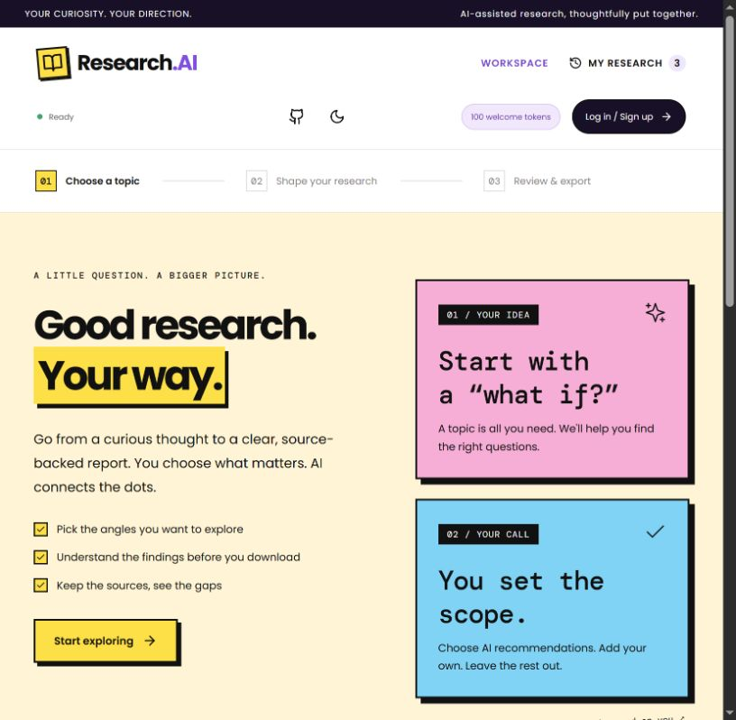
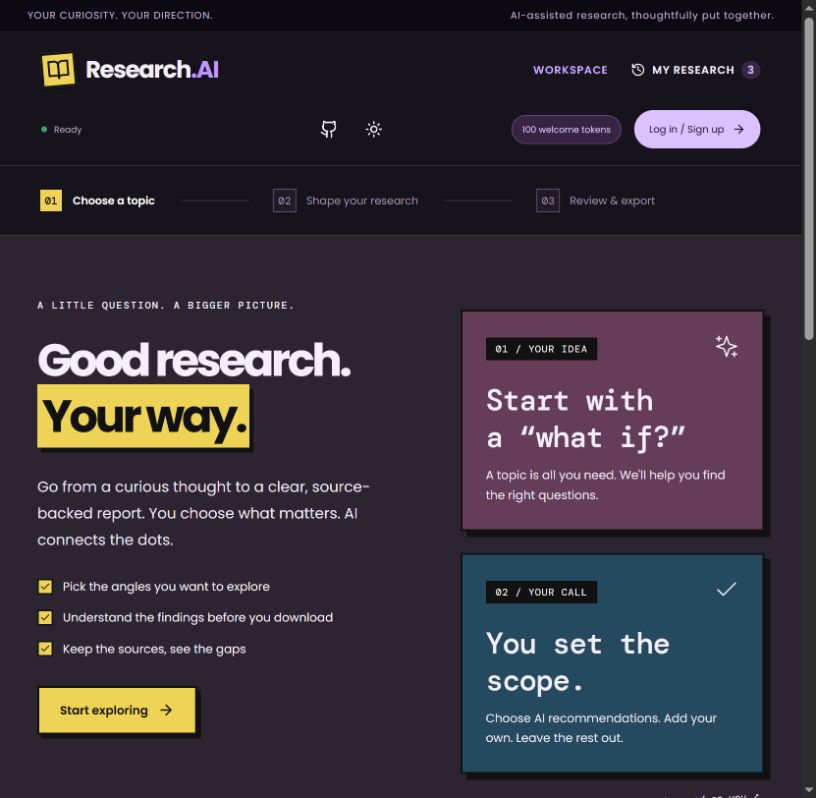
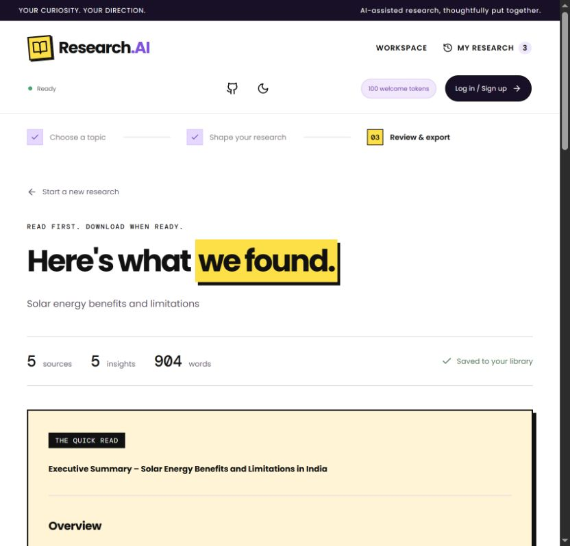

<div align="center">

# Research.AI

**Choose the scope. Review the findings. Export when ready.**

A research workspace built with React, FastAPI, LangGraph and Groq.

[](https://github.com/sudhanshu9944/Agentic-AI-Research-Assistant-main/actions/workflows/quality.yml)

[Live demo](https://agentic-ai-research-assistant-main.vercel.app/) · [Getting started](#getting-started) · [How it works](#how-it-works) · [Architecture](docs/ARCHITECTURE.md) · [Deployment](docs/DEPLOYMENT.md)

</div>



## Overview

Research.AI turns a topic into a report you can inspect before downloading.
Choose from suggested research angles, add your own, and review the summary,
sources and evidence gaps before generating a PDF or Markdown file.

| Feature | What you can do |
| --- | --- |
| Guided research | Choose suggested angles with checkboxes or add a custom topic. |
| Review before export | Read the summary, selected scope, excluded topics and evidence gaps. |
| Source references | Inspect the public search excerpts used in the report. |
| PDF and Markdown | Download the reviewed report in either format. |
| Research library | Reopen reports saved by the backend installation. |
| Light and dark mode | Keep your preferred theme across visits. |
| Local accounts | Sign up in your browser and track demo app tokens. |

<details>
<summary><strong>Dark mode</strong></summary>



</details>

<details>
<summary><strong>Research preview</strong></summary>



</details>

## Getting started

Install **Python 3.12**, **Node.js 24** and Git, then download the ZIP or clone:

```powershell
git clone https://github.com/sudhanshu9944/Agentic-AI-Research-Assistant-main.git
cd Agentic-AI-Research-Assistant-main
```

Run the following commands from this project folder.

**1. Install the backend**

```powershell
py -3.12 -m venv .venv
.venv\Scripts\python.exe -m pip install -r requirements-dev.txt
```

**2. Configure the API key**

Copy `.env.example` to `.env` if the file does not already exist. Open `.env`
and set `GROQ_API_KEY` to your own Groq key. Keep this file private.

```powershell
Copy-Item .env.example .env
notepad .env
```

Run the copy command only for the first setup; do not overwrite an existing key.
Inside `.env`, replace the placeholder with the key from your Groq account:

```dotenv
GROQ_API_KEY=your_groq_api_key_here
OPENROUTER_BASE_URL=https://api.groq.com/openai/v1
DEFAULT_MODEL=openai/gpt-oss-120b
RERANKER_MODEL=openai/gpt-oss-20b
```

No source-code edit is needed to replace a Groq key. Save `.env` and restart the
backend after changing it. `.env` is excluded from Git and the downloadable ZIP.

**3. Start the backend**

```powershell
.venv\Scripts\python.exe -m uvicorn backend.main:app --host 127.0.0.1 --port 8000
```

**4. Start the frontend in a second terminal**

```powershell
cd frontend
npm ci
npm run dev
```

Open **http://127.0.0.1:5173**. Keep both terminals running.

See the [local setup guide](docs/LOCAL_SETUP.md) for macOS/Linux, daily startup,
API-key replacement, configuration and troubleshooting. The backend's API
reference is available at **http://127.0.0.1:8000/docs** while it is running.

## API and model settings

| Change | Where to edit | Apply the change |
| --- | --- | --- |
| Groq API key | Root `.env`: `GROQ_API_KEY` | Restart the backend. |
| Provider base URL | Root `.env`: `OPENROUTER_BASE_URL` | Use an OpenAI-compatible provider and its matching key; restart backend. |
| Backend default/ranking models | Root `.env`: `DEFAULT_MODEL`, `RERANKER_MODEL` | Use model IDs supported by that provider; restart backend. |
| Model choices shown in the UI | `frontend/src/features/research/config.js`: `MODELS` | Update IDs/labels for a new provider; Vite reloads in development. |
| Deployed backend key | Vercel project → Settings → Environment Variables: `GROQ_API_KEY` | Save for Production/Preview as needed, then redeploy. |

The selected model in **Research preferences** is sent with each research
request, so changing only the backend default does not replace the UI's selected
model. API configuration is loaded by `backend/config.py`; keep actual keys out
of that file and all frontend files. For ordinary local use leave `VERCEL` unset;
private Blob storage and `SESSION_SECRET` are needed only for hosted deployment.

After the first installation, start just the backend command and `npm run dev`
in two terminals; `npm ci` and Python dependency installation need not run daily.
Stop both servers with Ctrl+C.

## How it works

1. Create a browser-local account or log in to an existing one.
2. Enter a topic and request suggested research angles.
3. Select the angles to include; add a custom angle if needed.
4. Run the research and review the findings, sources and limitations.
5. Choose **Generate PDF** or **Markdown** when the report is ready.

| Demo app tokens | Amount |
| --- | ---: |
| New account | 100 |
| Topic recommendations | 2 |
| Research | 10 |
| PDF / Markdown export | 0 |

Failed operations refund their reserved app tokens. These browser-local credits
are separate from the AI provider's actual quota.

## Project structure

```text
backend/
  api/              Request validation and HTTP routes
  agents/           Planning, research, analysis and report generation
  graph/            Workflow composition
  services/         Model calls and relevance ranking
  tools/            Public search adapters
  memory/           Saved research sessions
  export/           PDF, Markdown and bundled fonts
frontend/
  src/app/          App composition and workflow state
  src/features/     Research, local accounts and theme
  src/components/   Shared interface components
  src/services/     API client, downloads and link validation
  src/styles/       Layout, components, themes and responsive styles
  tests/            Frontend behavior tests
tests/              Backend regression and security tests
docs/               Setup, architecture and deployment
```

The [architecture guide](docs/ARCHITECTURE.md) explains the request flow and
module boundaries.

## Development

From the project root:

```powershell
.venv\Scripts\python.exe -m ruff check backend tests
.venv\Scripts\python.exe -m ruff format --check backend tests
.venv\Scripts\python.exe -m pytest -q
```

From `frontend`:

```sh
npm run format:check
npm run lint
npm test
npm run build
```

The same checks run through GitHub Actions on pushes and pull requests.

## Deployment and privacy

Vercel runs the React frontend and FastAPI API together. Reports use private
Blob storage, separated by a signed browser workspace cookie. Follow the
[deployment guide](docs/DEPLOYMENT.md) for environment and storage setup.
Local development keeps the existing file-based report library.

Accounts and demo credits stay in your browser. They are not server accounts or
enforced API quotas. Clearing the hosted workspace cookie loses access to that
browser's saved reports. Use provider free-tier limits for demonstrations; public
paid usage needs server authentication and abuse controls. See
[SECURITY.md](SECURITY.md) for the boundaries.

Research uses public search excerpts. It does not ingest uploaded PDFs or run
OCR. Search availability and free-provider quotas can affect results.

---

<div align="center">

Made with ❤️ by **Sudhanshu Singh, Himanshu Chauhan, Tanmay Pahuja**

*Built with ❤️ using* React · FastAPI · LangGraph · Groq

</div>
